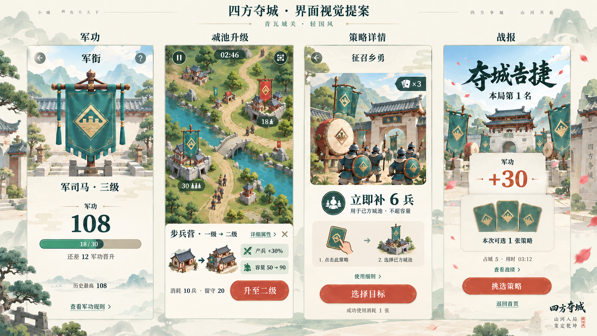

# 四方夺城 · 四页视觉提案

状态：2026-09-12，用户已选择方案 A，已完成全部页面本地统一；进度见开发计划。目录仅保存评审图片、生成提示词和制作要点，不作为运行时资源。

## 首页静态提案（2026-09-19，2026-09-20 已选并本地实现）

用户确定当前名称为“谋定山河”，批准精修稿作为首页及后续地图／说明页风格基准。[当前运行首页](home-courtyard-runtime.png) 来自 375×812 独立浏览器首次进入，本轮实际实现及素材提示词见 [制作记录](home-courtyard-production.md)。下方为保留的静态提案制作过程，不代表仍待实施；微信真机体验仍待验。

[首页静态稿：三国城关·出征前庭](home-courtyard-v1.png)，853×1844，约为 375∶812 的竖屏比例。沿用方案 A 的青瓦、灰石、朱漆，场景加入列队军士、巡逻兵和马厩；缩小标题与军衔，将三个次入口移到底部，出征牌独立居中，侧边小地图表示战前情报。图中“中郎将”为排版示例，不代表实际玩家军衔；胶囊仅示意系统占位，实施时由微信绘制，不能烘焙进场景。

内置 imagegen 生成后进行一轮定向修订，缩小标题／出征牌，去除卷曲金饰并统一手绘质感。已目视检查最终主标题、军衔、出征及三个入口文字和布局。该稿仅供风格与构图评审，尚未拆分素材、实现交互或验证真机。建筑与士兵是新概念造型，后续需与现有战场素材统一，不能声称已复用同一图集。首页恢复、结算与领奖优先级沿用现行规则；图稿中的静态“出征”不是所有状态下的固定文案。

完整提示词：[初稿](home-courtyard-prompt.txt)、[定向修订](home-courtyard-refinement-prompt.txt)。本轮未改运行资源或游戏代码。

## 评审稿

[最终整板](four-screens-refined.png) 是本次评审版本；[初稿](four-screens.png) 保留作对照。修订仅压缩升级页操作卡至约底部 35%，扩大可见战场。

## 共同风格

采用明亮、具立体感的青瓦城关，城墙用暖白与浅石色，军旗用青绿，主动作少量朱红。菱形城垛纹贯穿军衔旗、盾牌和策略卡背，形成同一套识别。军功页看军衔旗，升级页看建筑变化，策略页看效果，战报页看本局收益。

正文保留清晰黑体，短标题允许有书写感；图形承载情绪，实时文字承载规则。每页只有一个视觉上最突出的主动作；不增加货币、广告、养成材料或额外奖励。

## 四页制作合同

| 页面 | 默认主信息 | 展开后信息 | 操作与边界 |
| --- | --- | --- | --- |
| 军功／军衔 | 军衔旗、当前军功、距下一阶进度 | 获得／扣除规则、军衔路线 | 进度为荣誉成长，不增加战斗属性。小问号与“查看军功规则”指向同一说明；实际落地可只保留一个入口。 |
| 城池升级 | 同类建筑前后对照、产兵与容量收益、消耗和留守 | 精确产速、门槛、塔射变化 | 一次确认；成功后回战场，不播放免费加兵。未达门槛显示差额，满级没有升级按钮，敌营只能查询。 |
| 策略详情 | 插画、即时效果、目标类型和库存 | 容量上限、续时、解锁及到期等边界 | 图中“选择目标”仅用于战内入口：关闭详情回战场进入待施策，仍需合法目标提交成功才消费。从战前／卡册进入时主动作应为“返回战前／返回卡册”，不能远程施策。四卡直接改选与轻点取消保留。 |
| 战报 | 胜负／名次、军功实际增减、应有奖励机会 | 四方战绩与计分原因 | 图中为有效独立第一，有选卡机会时主动作“挑选策略”；无奖励机会时为“再来一局”进入战前。失败、并列、无有效派兵和教学分别用真实结果，不共用胜利模板。 |

## 样例与规则核对

- 军功 108 对应军司马三级；当前阶进度 18／30，再获 12 到下一阶，符合现行每阶 30 军功。历史最高 108 为样例。
- 一级步营自然产兵倍率从 1 到 1.3，因此图示 +30%；容量 50→90、30 兵消耗 10 后留守 20。此处示例没有被动增益。二升三及带被动时必须从真实状态计算，不能复用 +30% 或固定容量。
- 乡勇立即最多补 6 兵，受真实容量限制；示例库存 3 张，成功施策消耗 1 张。
- 战报展示有效正式独立第一的 +30 军功及唯一一次选卡机会；三张背面只是候选示意，实际一至三候选按真实记录展示，只能领取一张。
- 战场上的河流、桥、城池与路线用于表达美术方向，不是新的地图规则；生产实现保持现有地图 ID、合法道路、营地类型和阵营旗形。示例桥梁不自动成为新地形机制。

## 落地约束

这是静态美术评审图，不是可点击原型、微信模拟器截图或真机验收。画中数字与文案最终均须用 Canvas 实时绘制，不能作为文字图片烘焙；系统胶囊、安全区、44 px 命中、320／375／430 可读性需在实现时逐项验证。

升级在视觉样稿中占约底部 35%；实现时在小屏优先缩小建筑对照，保留成本和主按钮，地图坐标不能因展开而移动。满仓、停产、三级、库存不足、未解锁、存储失败与减少动态均沿用原有效规则。军衔旗轻摆、升级添层、策略效果短演示和战报落印仅作为动效方向，不阻塞操作或推迟结算。

## 生成记录

使用内置 imagegen 工具生成原创视觉提案。未使用现有商业游戏人物、标志或页面作为编辑底图。

- [初始完整提示词](prompt.txt)
- [升级页定向修订提示词](refinement-prompt.txt)

逐项检查已核对四页主次、中文主要标题、样例军功／升级／乡勇／选卡数字及修订后升级面板占比。未修改游戏代码，未改变当前规则和存档。
# 2026-11-09 逐页场景设计

以当前首页为基准的全部页面设计，包含独立场景、字阶、地图与动效规格，以及可切换的页面稿，见 [逐页设计预览](page-design/README.md)。设计与正式实现分开记录，进度仍以 docs/10 为准。
