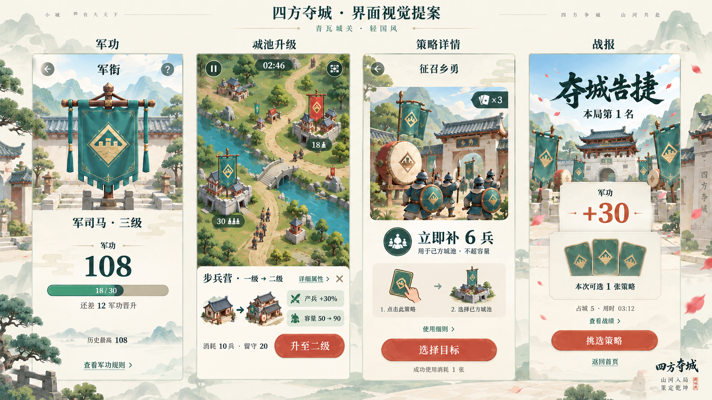
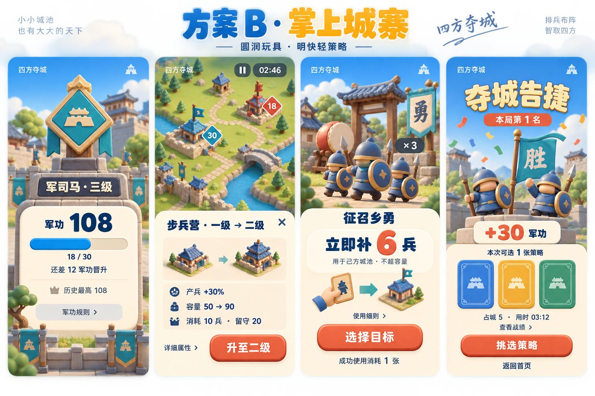
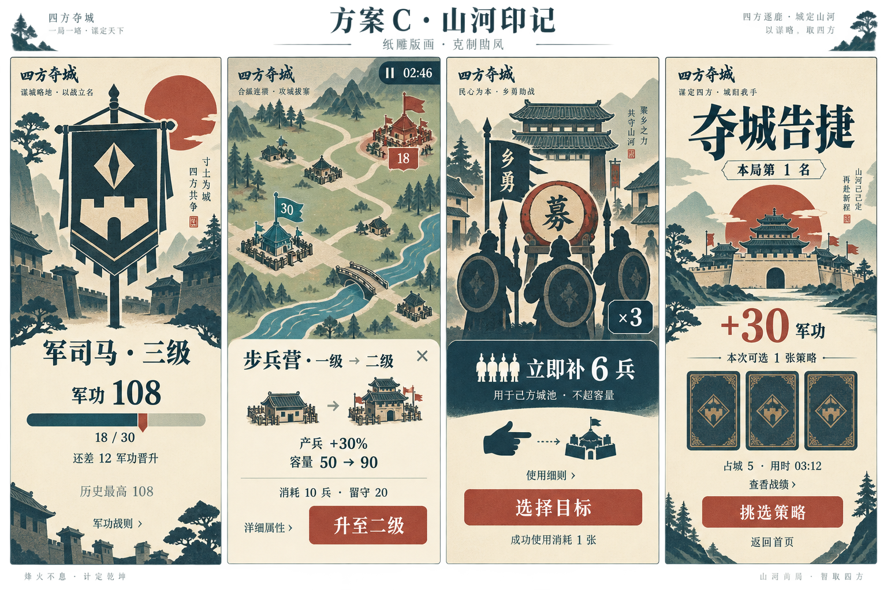

# 三种界面风格对比

状态：视觉选型，未接入游戏。A 为上一轮已制作提案，B／C 为本轮新增原创风格稿；每套均包含军功、升级、乡勇详情和有效冠军战报，示例规则相同。

| 方案 | 主要视觉语言 | 风格取舍 |
| --- | --- | --- |
| A 青瓦城关 | 明亮设色山水、青绿军旗、具立体感的古典建筑 | 传统国风氛围较强，场景细节较多。 |
| B 掌上城寨 | 圆润玩具建筑、短小军士、大图标、蓝黄主色 | 三者中更活泼亲切、动作更醒目；须接受更卡通的整体气质。 |
| C 山河印记 | 靛青与朱砂、版画剪影、纸层轮廓 | 更克制，平面图形识别突出；气质较沉静，动态需要补足战斗活力。 |

## A · 青瓦城关

[A 设计说明](../ui-direction-v2/README.md)

## B · 掌上城寨

[查看 B 原图](style-b-toy.png) · [完整生成提示词](toy-prompt.txt)

## C · 山河印记

[查看 C 原图](style-c-print.png) · [完整生成提示词](paper-prompt.txt)

## 选择与落地边界

本轮采用内置 imagegen 工具分别生成两套概念板；已检查四页主体、主要中文及示例数值。108 军功／军司马三级、18／30 阶内进度、升级消耗 10 留守 20、乡勇最多补 6、有效冠军 +30 且只选一张均沿用原规则。候选卡背不表示同时获得三张，示例地形不新增道路机制。

本次比较的是色彩、造型、材质、字体气质与信息主次，并非可点击原型或精确像素规范。B／C 生成稿的升级区域仍大于目标底部约 35%；选定风格后应沿用 A 修订稿的紧凑操作比例，保留战场。C 外板深色阴影只属于展示包装，不能移入游戏造成标题对比不足。

三套最终实施均需补齐返回与关闭入口、真实微信安全区、不同结果／不足／失败状态。文字、数值和触摸区域独立实时绘制；不直接把整张概念图作为可玩界面。未修改游戏代码、经济、存档或运行时素材。

基于用户希望轻量、易读的方向，优先建议评审 B；若更重视古典氛围则比较 A，若更喜欢平面美术与克制气质则比较 C。此建议为设计取舍，不代表已经验证用户留存或市场偏好。宜先确定一套主体语言，再调整个别颜色；不将三套人物、建筑与控件随意拼接。
